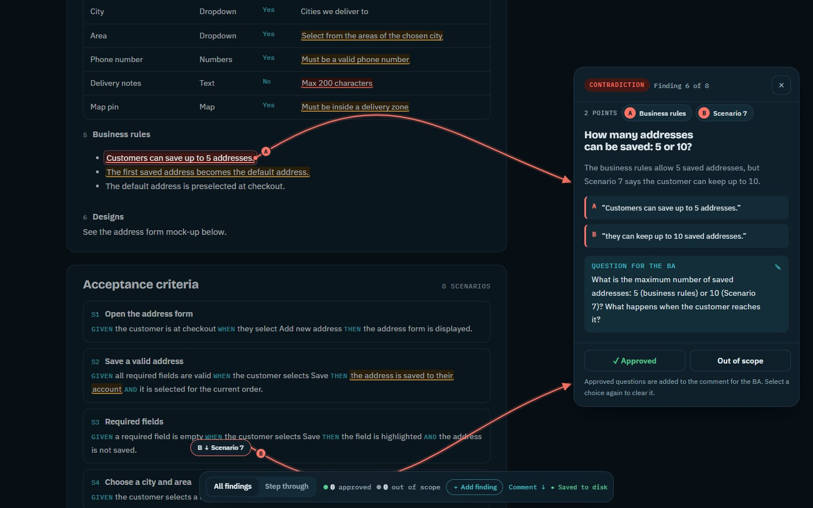
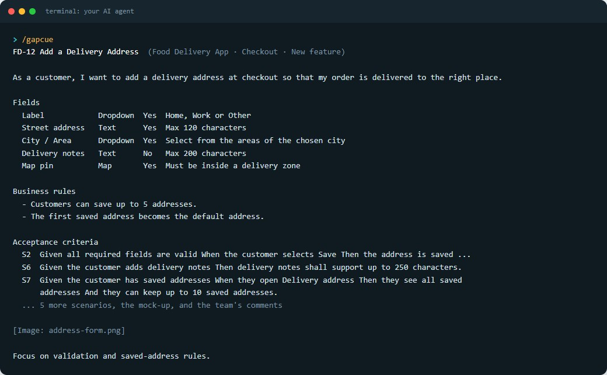
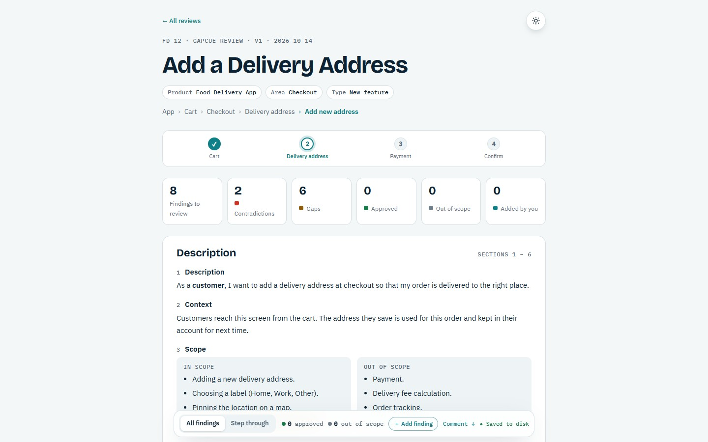
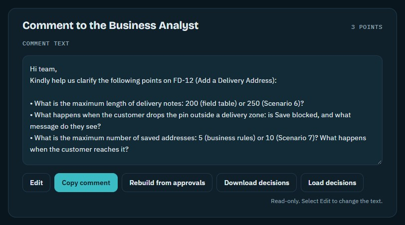
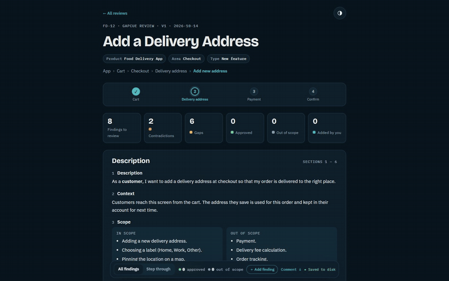
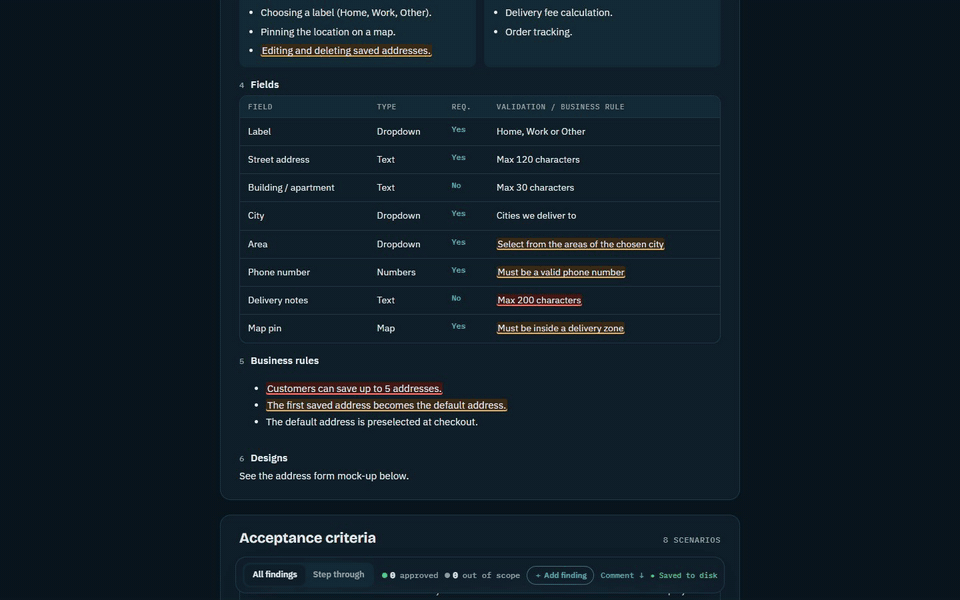
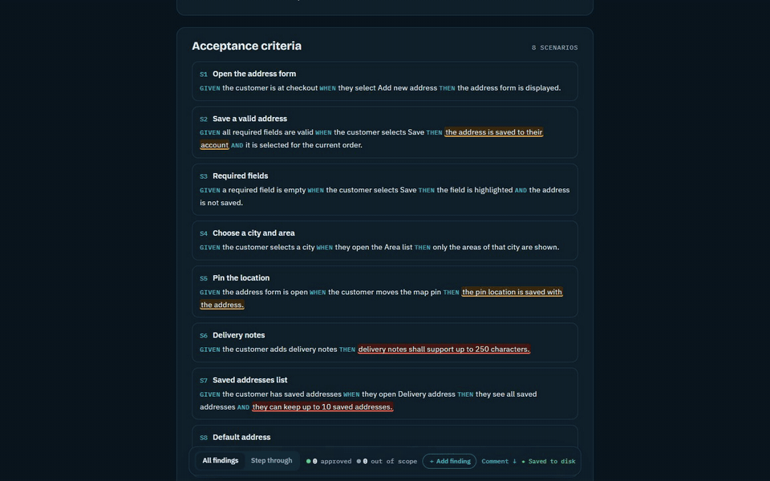
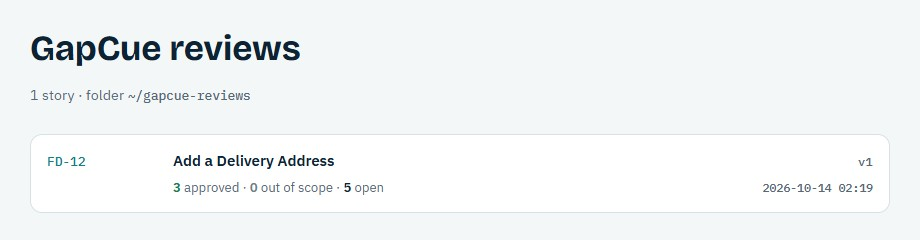

<div align="center">

# GapCue

### Spot gaps. Ask better questions.

**Paste a user story. GapCue helps you spot the gaps and contradictions,<br>and drafts the questions for your BA.**

[](CHANGELOG.md)
[](../LICENSE)
[](#claude-code)
[](#codex-cursor-gemini-cli-and-others)

**[Why](#why-gapcue) · [Features](#what-you-get) · [Install](#pick-your-app) · [How to use](#how-to-use) · [Tips](#tips--tricks) · [Saved reviews](#where-your-reviews-are-saved) · [FAQ](#faq)**



</div>

## Why GapCue

**Before:** you ask an AI for a gap analysis and get a wall of Markdown back:

```markdown
## Gap analysis: FD-12 Add a delivery address
1. **Address limit unclear**: the business rules say 5, but one scenario says 10.
2. **Delivery notes length**: 200 characters in the field table vs 250 in Scenario 6.
3. **Area list**: what is shown before a city is chosen?
4. ...
### Questions for the BA
- What is the maximum number of saved addresses?
- ...
```

Then the real work starts. You scroll the story to find each sentence it means. You can't see which two lines
contradict each other. You copy the questions you agree with by hand. A week later, it's lost in a chat.

**After:** GapCue puts every finding **on the story itself**. Contradictions are linked with arrows, you approve or
drop each one with a click, and the questions you approve become a comment ready to send. Every review is saved,
with versions.

| You paste this… | …and get this |
|---|---|
|  |  |

…and at the end, a comment for your BA with only the questions you approved:



## What you get

| | |
|---|---|
| 🔎 **The gaps that matter** | GapCue reads the story like a senior QA + BA and lists what blocks development or testing. It skips what your team already asked in the comments. |
| 🔗 **Contradictions you can see** | Conflicting statements are highlighted in red and linked to the explanation with curved arrows. |
| ✅ **Your call on each finding** | Mark each one **Approved** or **Out of scope**, or go through them one by one with **Step through**. |
| ✍️ **Add what the AI missed** | Select any text in the story → **Gap** or **Contradiction** → write your question. |
| 🎨 **Pick your theme** | Auto, Light, Dark, Paper or Midnight, from the round button at the top of the page. |
| 🔔 **Know when there's an update** | GapCue tells you when a new version is out, and how to update. |
| 📋 **A comment ready to send** | Every approved question lands in a tidy comment for your Business Analyst. Copy and paste. |



## Pick your app

| You use | Install | Status |
|---|---|---|
| **Claude Code** | [as a plugin](#claude-code) | 🔜 Checked at first release |
| **Codex, Cursor, Gemini CLI, GitHub Copilot, OpenCode…** | [with `npx skills`](#codex-cursor-gemini-cli-and-others) | 🔜 Checked at first release |
| **Claude app** (web / desktop) | [upload the ZIP](#claude-app-and-chatgpt-beta) | 🧪 Beta, not tested yet |
| **ChatGPT** | [upload the ZIP](#claude-app-and-chatgpt-beta) | 🧪 Beta, not tested yet |

You need **[Node.js](https://nodejs.org) 18 or newer** on your computer for the review page (CLI apps).

---

### Claude Code

<details open>
<summary><b>Install</b></summary>

1. In Claude Code, add this collection once:
   ```
   /plugin marketplace add Red-Cloud2000/skills
   ```
2. Install GapCue:
   ```
   /plugin install gapcue@red-cloud-skills
   ```
3. Start a new session. That's it.
</details>

<details>
<summary><b>Update</b></summary>

- Run `claude plugin update gapcue@red-cloud-skills` in your terminal, **or**
- turn on auto-update for the `red-cloud-skills` marketplace once
  ([how](https://code.claude.com/docs/en/plugins/host-marketplace#turn-on-auto-update)). New versions then install by themselves.
</details>

### Codex, Cursor, Gemini CLI and others

<details open>
<summary><b>Install</b></summary>

```bash
npx skills add Red-Cloud2000/skills --skill gapcue
```
It asks which agents, project or global, and symlink or copy. Add `-g` to install it for all your projects without the project question.
</details>

<details>
<summary><b>Update</b></summary>

```bash
npx skills update
```
If it says "up to date" but you know there's a new version, run the install command again.
</details>

### Claude app and ChatGPT (beta)

<details>
<summary><b>Install</b></summary>

1. Download **`gapcue.zip`** from the [latest release](https://github.com/Red-Cloud2000/skills/releases).
2. Upload it:
   - **Claude**: Customize → Skills → **+** → upload the ZIP ([help](https://support.claude.com/en/articles/12512180)). Needs a paid plan with code execution on.
   - **ChatGPT**: Skills → Create → Upload ([help](https://learn.chatgpt.com/docs/build-skills)). Availability depends on your plan.
3. In the app, GapCue gives you **one HTML file**. Download it and open it in your browser.
   Your decisions stay in that browser; use **Download decisions** to keep a copy.
</details>

<details>
<summary><b>Update</b></summary>

Download the new `gapcue.zip` and upload it again (replace the old skill).
</details>

### Manual install (any agent)

Copy the folder [`skills/gapcue`](skills/gapcue) into your agent's skills folder
(for Claude Code: `~/.claude/skills/gapcue`). To update, copy it again.

---

## How to use

1. **Paste your story** into the chat: title, description, acceptance criteria, comments, and any screenshots.
2. Say **"review this story"** (or "gap analysis", or "questions for the BA").
3. GapCue shows its findings in the chat, then asks **where to save** the review (your user folder, this project, or a folder you choose).
   If you reviewed the same story before, it asks whether to add a **new version** or **replace** the old one.
4. Your browser opens the **review page**:
   - Click a highlight to see the problem and the question. Choose **Approved** or **Out of scope**.
   - Select **✎** on a question to reword it before you approve it.
   - Use **Step through** (bottom bar, or ← →) to go one finding at a time.

     

   - To add your own finding, **select text** → **＋ Gap** or **⇄ Contradiction** (keys G / C) → write the question → **Add to comment**.

     

   - At the bottom, **Copy comment** and send it to your BA.

## Tips & tricks

### 🎯 Steer it with your own words
After the story, add a line or two of your own: what to focus on, what to skip, or context that isn't written in the story.

```
/gapcue
<paste the story here>

Focus on payment and refund rules; skip UI wording.
Context: refunds use the existing Payments API, max 3 refunds per customer per day.
```
(Installed as a Claude Code plugin, the command is `/gapcue:gapcue`. In other agents, write "use GapCue" instead.)

### 🤑😎 Got more than one frontier model? Use both
Let Claude do the analysis, then have Codex review it before the page is built. Two models catch more than one.
Use [**codex-delegate**](https://github.com/amElnagdy/delegate-skills/tree/main/skills/codex-delegate) from
[delegate-skills](https://github.com/amElnagdy/delegate-skills) by Ahmed Nagdy:

```bash
npx skills add amElnagdy/delegate-skills --skill codex-delegate
```
```
/gapcue
<paste the story here>

After your analysis, before you build the page, use codex-delegate in read-only mode to have Codex
review your findings: gaps you missed, findings that aren't real problems, and unclear BA questions.
Keep only what you agree with, and tell me what changed.
```

### 🔁 Review again after the BA replies
Paste the updated story and choose **New version**. Your decisions and your own findings carry over to findings that
still apply, and the old version stays in your history.

## Where your reviews are saved

```
gapcue-reviews/
├─ index.html               ← history of all your reviews (open it any time)
└─ FD-12/
   ├─ v1/index.html         ← a review
   └─ v2/…                  ← a newer version of the same story
```



- Decisions are saved next to each review (`state.json`), so they survive closing the browser or the terminal.
- To reopen your history, ask your agent to "open my GapCue reviews", or double-click `gapcue-reviews/index.html`.
- To share a review, send its folder (or commit it to your repo).

## FAQ

<details><summary><b>The page says "Saved in this browser"</b></summary>

You opened the file directly (or in app mode). Your decisions are kept in this browser. Open the review through your
agent ("open my GapCue reviews") to save them to disk, or use **Download decisions**.
</details>

<details><summary><b>The server stopped / I closed the terminal</b></summary>

Nothing is lost. Ask your agent to open your GapCue reviews again, or double-click `index.html` in the reviews folder.
</details>

<details><summary><b>Port 8765 is busy</b></summary>

GapCue picks a free port by itself and prints the link.
</details>

<details><summary><b>An old review looks different from a new one</b></summary>

Each review keeps the page design it was built with. Re-run the story and choose **New version** or **Replace** to get the latest design.
</details>

<details><summary><b>Does GapCue send my stories anywhere?</b></summary>

The review page and server run only on your computer (`127.0.0.1`). Once a day at most, the CLI asks GitHub for
GapCue's latest version number (nothing about your story is sent) so it can tell you when an update is out. To turn
that off, set `GAPCUE_NO_UPDATE_CHECK=1`. The analysis itself is done by the AI agent
you already use, under that app's own privacy terms.
</details>

## Example: input and output

- **Input:** a food-delivery story, "FD-12 Add a delivery address" (description, field table, business rules,
  8 scenarios, a mock-up and team comments). The prepared version is in
  [`examples/sample.json`](skills/gapcue/examples/sample.json).
- **Output:** the review page and the BA comment shown in [Why GapCue](#why-gapcue).

To see it yourself, ask your agent: *"build the GapCue sample review"*.

## Contributing

Issues and ideas are welcome. Maintainers: every release follows [RELEASING.md](../RELEASING.md).

## License

[MIT](../LICENSE) © Abdelrahman Hesham
